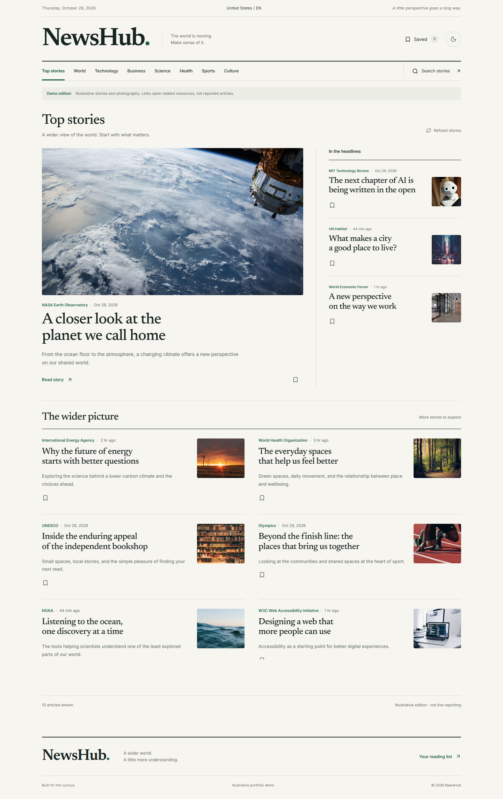

# NewsHub

An editorial news reader redesigned from a second-year student project into a focused portfolio application.



## What it does

- Headlines and category editions with a lead story, supporting headlines, and compact rows.
- URL-driven search with cancellation, history support, loading/error states, and retry.
- A device-local reading list with persistence, remove/undo, and confirmed clear-all.
- Light/dark themes, keyboard navigation, visible focus, accessible controls, and responsive layouts.
- Explicit demo mode with original illustrative stories; optional server-side GNews integration.
- Shared caching and atomic request budgets for live production.

No accounts, AI summaries, infinite scrolling, or email delivery are included.

## Run locally

Use Node **24 LTS (24.15 or later)** and npm. Node 22.22.2+ LTS is also supported. The lockfile is committed.

```sh
git clone https://github.com/mashudSCK/NewsHub.git
cd NewsHub
# Check out the redesign branch after these changes have been pushed.
npm ci
```

If using the supplied source archive, extract it and run the following from its project folder:

```sh
npm ci
cp .env.example .env.local
npm run dev
```

On PowerShell, use `Copy-Item .env.example .env.local`. Open [localhost:3000](http://localhost:3000).

Demo mode is the default and requires no credentials. Every page labels its stories and photography as illustrative. Resource links are not claimed to be original reported articles.

Production preview:

```sh
npm run build
npm run start
```

## Optional live news

Set `NEWS_MODE=live` and `GNEWS_API_KEY` in `.env.local`. Never prefix secrets with `NEXT_PUBLIC_`. Choose `NEWS_COUNTRY` from `us, gb, ph, au, ca, in`, and `NEWS_LANGUAGE` from `en, es, fr, de, ja`.

For a production live deployment, also configure `UPSTASH_REDIS_REST_URL` and `UPSTASH_REDIS_REST_TOKEN`. Local development may use a bounded in-memory store; production fails closed without shared storage. No provider failure silently switches to demo data.

Headline cache: 10 minutes. Search cache: 5 minutes. Results are capped at 10. The default upstream budget is 90 requests per UTC day; set it below your actual account allowance. The conservative per-client limit is 30 requests/minute; without an explicitly trusted hosting header, callers share one bucket.

See [provider contract and launch checks](docs/provider-contract.md) for account eligibility, trusted headers, limits, image handling, and unverified deployment prerequisites. No paid service is required for the demo.

## Architecture

```text
app/                        Route composition and thin API endpoints
components/news/            Editorial feed, stories, images and state UI
context/                    Theme and browser-local bookmark persistence
hooks/useNewsFeed.ts         Request state, aborts and stale-response protection
lib/news/                   Normalized types, provider adapter, cache and limits
tests/news/                 Provider, race, persistence and rendering regressions
tests/e2e/                  Browser journeys and automated accessibility checks
scripts/                    Reproducible screenshots and performance measurements
docs/                       Design, implementation plan, case study and evidence
```

Next.js 16 and React 19 preserve the original App Router foundation. The upgrade addresses advisories found in the original dependency tree. Tailwind remains available; the editorial visual system uses shared CSS tokens. Inter and Newsreader are bundled locally through next/font, so building does not require Google Fonts access.

Images load directly in the browser with no-referrer; the server does not proxy arbitrary publisher images. Missing/failed images use a neutral placeholder.

## Verification

```sh
npm run lint
npm run typecheck
npm test -- --run
npm run build
npx playwright install chromium
npm run test:e2e
```

CI uses Chromium on Linux. Local browser tests and capture scripts use installed Microsoft Edge on Windows. To use downloaded Chromium locally instead, set `CI=1` for the test command, or adjust the documented `channel` option in `playwright.config.ts`.

The browser tests run a production server on port 3001. All API tests use fixtures/simulated external responses. No GNews credential is needed in CI.

To refresh evidence with a production server running at port 3001:

```sh
node scripts/capture.mjs
node scripts/audit.mjs
```

Audit scripts assume local Edge, use three mobile Lighthouse runs per page, and save raw reports plus medians. Results are environment-specific, not claims about deployed traffic.

## Portfolio material

Read [the case study](docs/case-study.md), [design system](DESIGN.md), and [verification report](docs/verification.md). Before/after captures use illustrative fixtures. No user research, commercial adoption, or performance improvement is claimed without evidence.

## Attribution

Original project: mashudSCK. The redesign was implemented with Codex assistance. News data in live mode: [GNews](https://gnews.io). Illustrative photography: Unsplash. Fonts: Inter and Newsreader (their bundled packages include the respective licenses). Icons: Lucide.

This checkout has not been pushed or deployed automatically.
