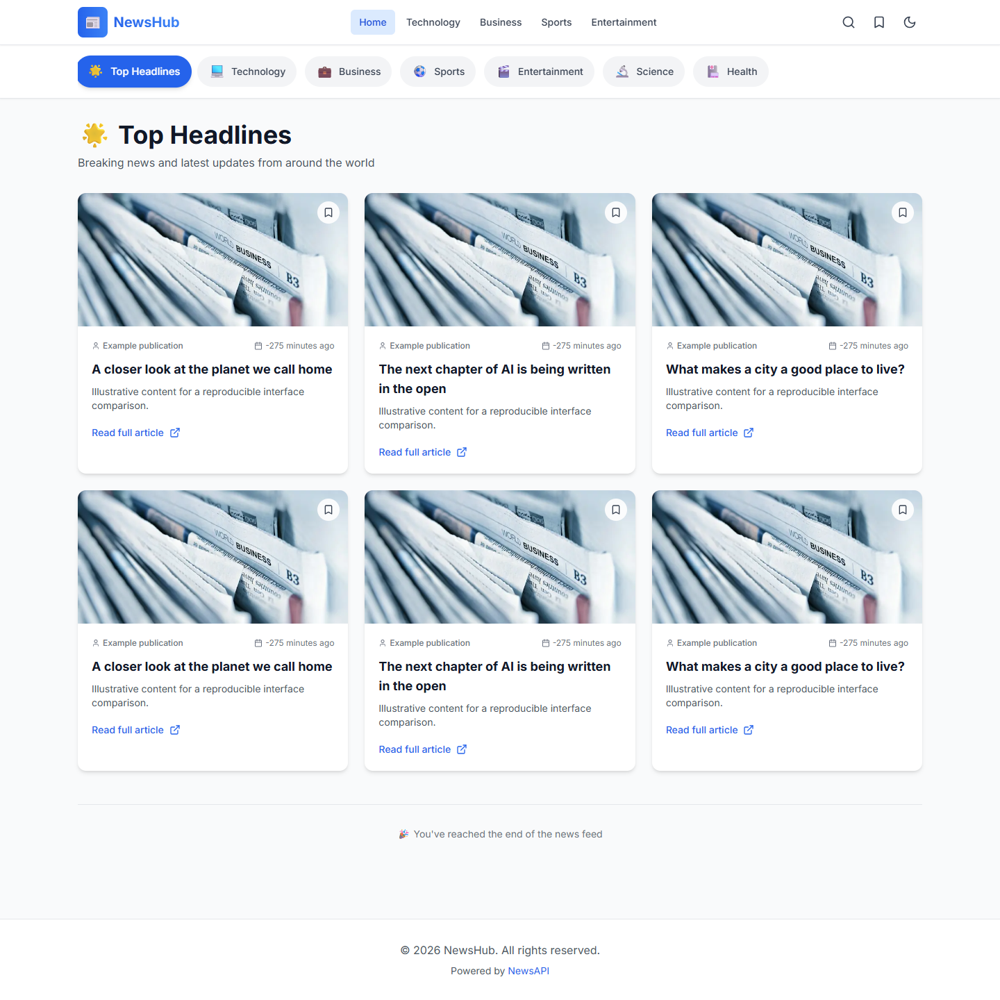
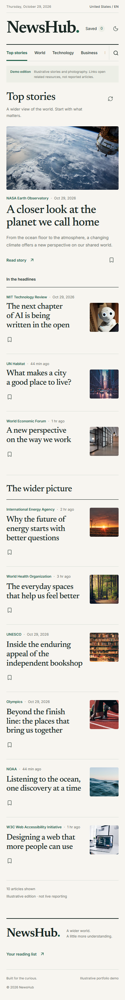

# NewsHub: from student aggregator to editorial reader

## Context

NewsHub began as a second-year student project using Next.js, Tailwind, and a news API. The redesign preserves the useful core—browse, search, save—and focuses on demonstrating design judgment and dependable implementation.

The original UI treated every story as an equally weighted card. Its data path accepted page numbers without sending them, the search skeleton condition excluded active searches, and several files mixed NewsAPI terminology with a GNews integration.

## Design decision

The chosen direction is an editorial newsroom: paper-toned surfaces, Newsreader headlines, Inter controls, a forest-green accent, and fine dividing rules. A lead story gives readers a starting point. Supporting headlines and compact rows allow faster scanning.

The mobile layout follows reading order instead of squeezing desktop columns. Dark mode uses the same hierarchy on forest-toned surfaces. Stock photography no longer stands in for missing article images; those use a neutral fallback.

The before and after show different amounts and types of illustrative content. They demonstrate layout changes, not an experimentally controlled conversion or performance improvement.

## Engineering decisions

One normalized Article contract separates provider details from the UI. Server routes validate inputs, keep credentials private, apply timeouts, and map failures to useful messages. A shared Redis REST store provides explicit cache lifetimes and atomic request budgets for live production. The bounded feed removes misleading pagination controls.

Search state follows the URL. Abort signals and request identity checks prevent an older response from replacing newer results. Saved articles use validated local data, preserve existing values during initialization, and support undoing the latest removal. Storage failures keep the reading session usable.

The old API diagnostic endpoint exposed a credential prefix and was removed. The original dependency lock contained critical advisories; the app and compatible tooling were upgraded, followed by build and regression checks.

## Evidence

See [verification.md](verification.md) for measured results and [performance-summary.json](evidence/performance-summary.json) for Lighthouse medians. The regression suite covers data normalization, query validation, quotas/cache behavior, stale responses, storage failures, and sparse article layouts. Browser checks cover the primary reading workflows, themes, mobile widths, keyboard access, retries, and category 404s.

Automated accessibility checks are evidence about tested pages, not a certification of accessibility. Local Lighthouse measurements do not predict every host, network, or publisher image.

## Scope and limits

This is a reader, not a publishing platform. There is no authentication, cross-device sync, AI summary generation, or ingestion pipeline. Demo articles are explicitly illustrative and link to related resources. Live GNews and shared Redis deployment still require credentials and an account/hosting configuration check.

No user research or adoption metrics were collected. A useful next evaluation would be watching readers find and save a story, then using those observations to improve navigation.

## Contribution and collaboration

The original student application belongs to mashudSCK. This redesign was developed with Codex assistance from an approved direction and implementation plan. When presenting it, explain the decisions you can substantiate and distinguish your original work, your design choices, and assisted implementation.
